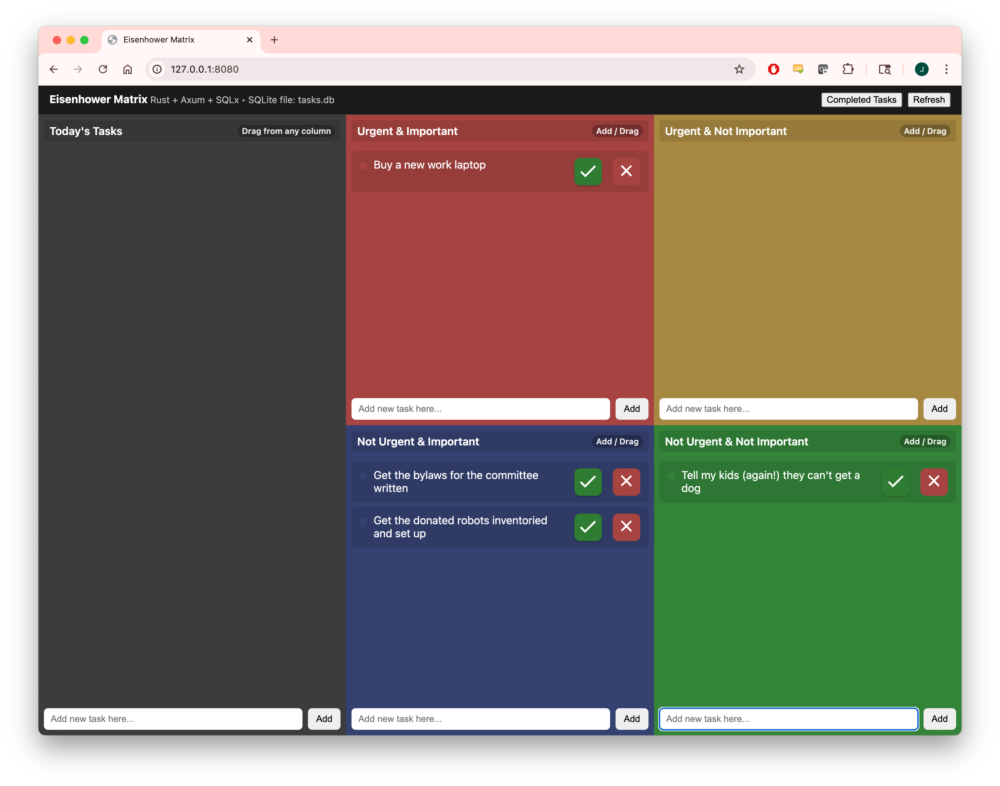
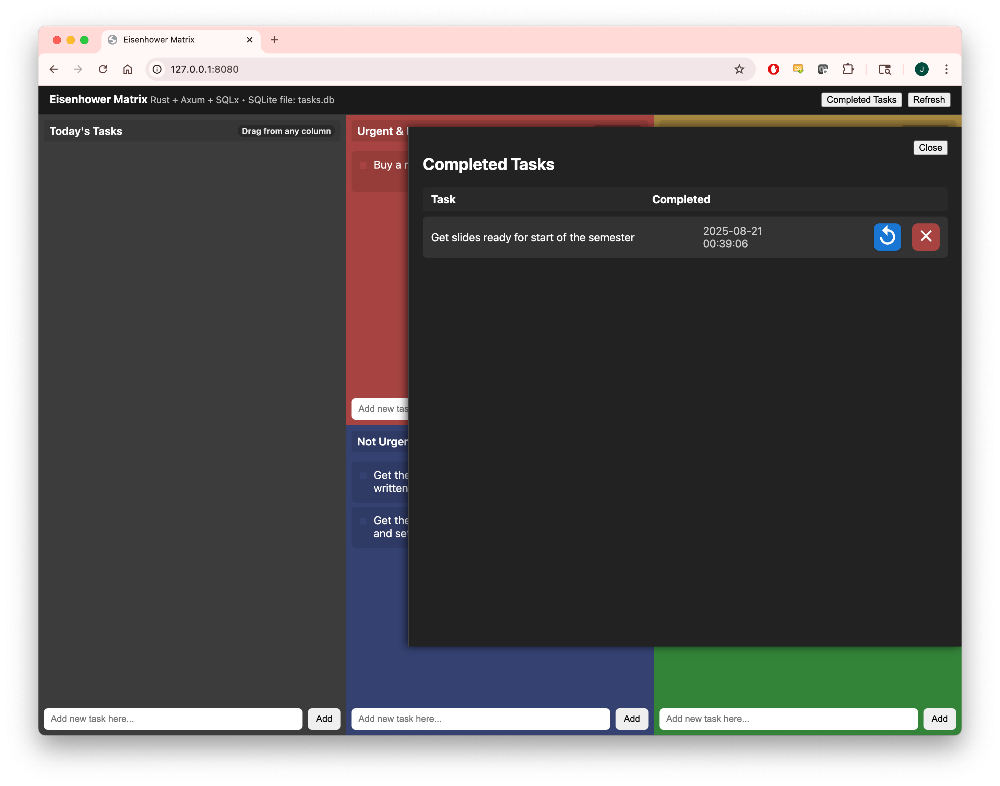

# EISENPOWER - Eisenhower Matrix with a current-day priority list : Rust + Axum + SQLite (+ optional Docker)

This is a modified form of the Eisenhower Matrix method for creating TODO lists according to urgency and importance. It also includes a Today's Tasks panel for ordering the tasks currently on the docket.

Several years ago I developed a version of this in Swift for MacOS and iOS, but that wasn't portable across devices, and wasn't web accessible. It also didn't track completed items and allow you to pull them out of the completed bin if you realized you weren't done yet.

Here are some of the features

- Drag & drop between columns to reorder/move.
- When dragging to the Today's Task list, it preserves which category it came from, in case you want to move it back to where it came from.
- Add tasks via the input at the bottom of each column.
- Click a task's text to edit. Automatically saved when navigating away.
- Create subtasks from any top-level task, collapse/expand them, and mark individual subtasks complete without hiding them.
- Drag a top-level task onto another task's subtask area to convert it into a subtask.
- Checkmark button to indicate the task is done and move it to the Completed Tasks list
- Completing a parent task completes all of its subtasks.
- X button to delete a task entirely.
- In the Completed Tasks panel, click the restore button to move the item back to the list of items still needing to be done.
- Sign in with one of the configured users. Each user's tasks live in a separate SQLite file under the data directory.
- The database schema is initialized by the application at startup; migrations are intentionally not used while the app is still pre-release.


*Note*: This was 100% done via vibe coding, using my Swift implementation from 8 years ago and a screenshot of that interface as the input. I consider myself a pretty good programmer, but this was an experiment about whether I could make a fully functioning app without actually doing any coding. During this whole process, I resisted the urge to jump in and make code corrections along the way. Instead I was using GPT4.1 and only giving it prompts about what features I wanted to add, how I was expecting it to behave, and how it actually behaved. This was in VSCode with Copilot, so it was often interpreting the compiler errors and acting accordingly. I have used AI a lot in my day-to-day coding, but never done the full 'vibe coding' thing. I usually just have it implement a function here or there where I am giving it a function signature or a data structure or a directive, then edit code, then have it optimize or improve, etc. This was wholly code written by it without any "coding intervention" by me.

## Screenshots





## How to Run

To run from the command line with the default `admin:password` login:

```
cargo run
```

To run with your own users and data directory:

```
EISENPOWER_USERS='admin:password,alice:correct-horse-battery-staple' \
EISENPOWER_DATA_DIR='./data' \
EISENPOWER_SESSION_SECRET='replace-this-with-a-long-random-secret' \
cargo run
```

For an optimized local build:

```
cargo run --release
```

Then open http://127.0.0.1:8080 and sign in with one of the configured users.

To run by creating a Docker image and container:

```
docker compose up --build
```

## Configuration

Users are configured with `EISENPOWER_USERS` as a comma-separated list of `username:password` pairs:

```
EISENPOWER_USERS='admin:password,alice:correct-horse-battery-staple' cargo run
```

By default the app creates one database per user in `data/<username>.db`. Change this with `EISENPOWER_DATA_DIR`. For shared or long-running deployments, set `EISENPOWER_SESSION_SECRET` so login cookies remain valid across restarts.

For Docker Compose, edit the `environment` section in `docker-compose.yaml` (or `docker-compose.yml` if you use that filename):

```yaml
environment:
  - EISENPOWER_USERS=admin:password,alice:correct-horse-battery-staple,bob:another-password
  - EISENPOWER_DATA_DIR=/app/data
  - EISENPOWER_SESSION_SECRET=replace-this-with-a-long-random-secret
  - PORT=8080
```

After saving the file, rebuild and launch:

```
docker compose up --build
```

Enjoy!
